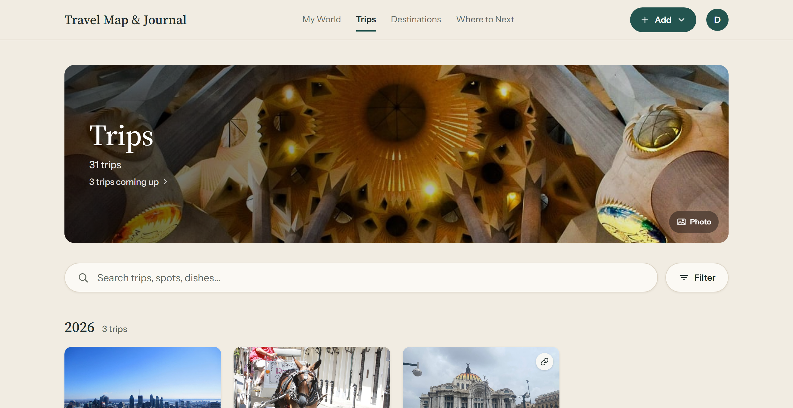

A friend says they're going to Mexico City and asks where you ate. You remember a seafood place. Very good tuna. Busy at lunch, near a park, maybe? You scroll through your photos and find a plate of tostadas with no name attached.

It happens to everyone. Food is one of the best parts of travelling, and it's also the part we keep the worst records of. Here's how to fix that.

## Why you forget them

Photos are the main record most of us keep, and a photo of a dish doesn't say where it was. The map pin on it is often off by a block. Booking apps only remember the places you reserved, and the best meals are often the ones you walked into.

Memory doesn't help either. After a week of new places, the names run together. A month later you remember the meal but not the restaurant.

## Write it down the same day

The fix is simple: save the place before you go to sleep. It takes a minute and you won't manage it a week later.

## Save more than the name

A name on its own is a start, but the details are what you'll want later:

- **What you ordered.** "Tuna tostadas" is what your friend actually needs to know.
- **How good it was.** Stars, or just "would go back" and "wouldn't".
- **A tip.** "Ask for the terrace." "Cash only." "Go before noon or there's a line."
- **Where it is.** Not a guess from a photo: the actual place, so it lands on a map.

That last one matters more than it seems. A list of names is hard to use on your next trip, but a map shows what's near where you're staying.

## Keep it with the trip

Keep restaurants together with the rest of the trip, not in a separate list. Then "where did we eat in Lisbon?" has a home, and you can see the meals next to the dates, the people you went with and what it all cost.

That's how Travel Map & Journal works. Each spot on a trip keeps its stars, your note and what you'd order again, and lands as a pin on [your travel map](/travel-map). Favorite the few you'd go back for, and they come first.

## Make it searchable

Years from now you won't remember which trip it was. Search fixes that. Being able to type "tostadas" and find the place from three trips ago is the point of writing down what you ordered.

## Pass it on

The best reason to keep good notes is that someone will ask. When they do, send them the whole city in one link instead of five texts and a screenshot. A [shared destination page](/share-travel-tips) has every spot you loved there, with your ratings and notes, and your friend doesn't need an account to open it.

Next trip, try it: one minute before bed, each night. When someone asks where you ate, you'll be able to tell them.
