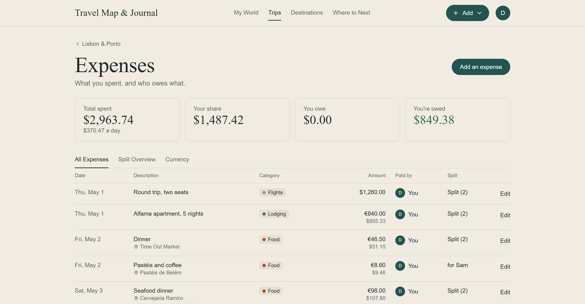

Group trips are great until the last night, when someone opens a notes app and starts adding up who paid for what. Add a second currency and a friend who lives in another country, and it gets messy fast.

None of this is hard if you decide a few things up front. Here's what works.

## Agree on three things before you go

**What's shared.** The apartment and the rental car, almost certainly. Groceries, probably. Each person's flights, usually not. Agree on it before anyone pays for anything, because it's an awkward conversation to have afterwards.

**Who logs it.** Either everyone adds what they paid as they go, or one person keeps the list. Both work. What doesn't work is "we'll sort it out at the end", because by then nobody remembers who paid for the second dinner.

**What currency you'll settle in.** If you all live in the same country, it's your own currency. If not, pick one, or use a tool that shows each person their own.

## Write down what you actually paid

Record every expense in the currency you paid it in: €42.50 for dinner, not "about $46". Converting in your head as you go adds a small error to every expense, and those add up.

It also means the record matches your receipts and your bank statement, which helps when someone asks "wait, what was this one?"

## Use the rate on the day you paid

When it's time to add things up, each expense needs converting. Use the exchange rate from the day you paid, not the day you settle. On a long trip, or one you settle weeks later, the difference is real.

The European Central Bank publishes a reference rate every working day, and it's what most currency tools use. It won't exactly match your card's rate, since banks add their own margin and fees. If that matters to your group, agree whether those fees are shared or each person's own. Most groups just let them go.

## Split it the way it really went

An equal split is fair for the apartment. For a lot of other things it isn't:

- **One person doesn't drink.** Split the bar bill between the people who did.
- **Someone joined halfway.** Split the car by days, or by shares (2 shares for the people there all week, 1 for the person there for half).
- **A shared receipt.** Split item by item, then spread the tax and tip in proportion.

Fair splits stop small resentments, and they're no extra work if your tool does the arithmetic.

## Settle up in as few payments as possible

Don't settle each expense separately. Add up what everyone paid and what everyone's share was, then settle the differences.

Say Ana, Ben and Cal share an apartment in Lisbon:

| Who paid | What | Amount |
| --- | --- | --- |
| Ana | Apartment | €600 |
| Ben | Dinner | €90 |
| Cal | Rental car | €150 |

The trip cost €840, so each person's share is €280. Ana paid €320 more than that; Ben paid €190 less, and Cal €130 less. So Ben sends Ana €190, Cal sends Ana €130, and everyone's even. That's two payments instead of six.

With more people and more expenses the arithmetic gets harder, but the idea's the same: work out each person's balance, then match the people who owe with the people who are owed.

## Or let an app do it

You can do all of this in a spreadsheet. If you'd rather not, [the trip expense splitter](/split-trip-costs) in Travel Map & Journal does it inside the trip itself: log each expense in any currency, split it equally, by shares, by percentages or item by item, and it works out the fewest payments to settle. Friends don't need an account to be part of the split, and each person sees the totals in their own currency.

Whichever way you do it, decide before you go, write it down as you go, and settle once. Then the last night of the trip can just be the last night of the trip.
