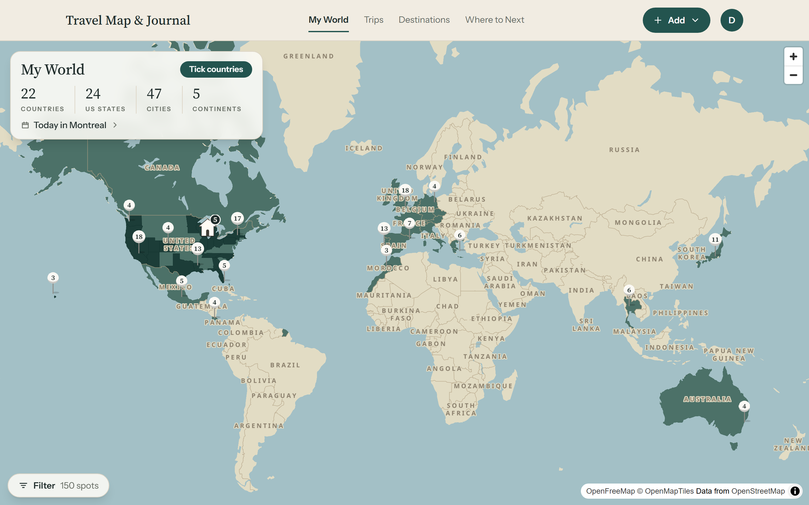

Ask someone how many countries they've been to and watch their face. There's a pause, some counting on fingers, a "does a layover count?", and then a number they're not quite sure of.

It's an easy thing to lose track of. Trips blur together, and the further back they go the less you remember. Here's how to get an accurate list and keep it that way.

## First, decide what counts

Before you count anything, settle your rule. People disagree on this, and there's no right answer, but you need one answer so your number means something. The usual ones, from loosest to strictest:

- **You landed there.** An airport layover counts. Most people find this too loose.
- **You left the airport.** You walked around, even for an afternoon.
- **You slept there.** At least one night.
- **You did something there.** A meal, a sight, a walk. Roughly "you could tell someone about it".

Then there's the question of what a country is. The UN has 193 members, but most people count places like Puerto Rico, Greenland or Hong Kong separately once they've been, and the Travelers' Century Club's list runs past 300. Pick a list you're happy with and stick to it.

## Pick where to keep the list

There are four common ways to do it. They all work; they differ in how much they remember besides the tick.

| | Good for | Falls short on |
| --- | --- | --- |
| Scratch-off map | Something to hang on the wall | No dates, no detail, hard to undo |
| Notes app | Quick, always with you | Turns into a long list nobody reads |
| Spreadsheet | Sorting, counting, adding columns | Fiddly on a phone, no map |
| A travel map app | The map fills itself in from your trips | You have to pick one you trust with years of data |

If you only want the number, a note on your phone is fine. If you want to remember the trips behind the number (when you went, where you stayed, the place you'd go back to), keep the list somewhere that holds trips, not just ticks.

That's how [the countries visited tracker](/countries-visited) in Travel Map & Journal works: add a trip and its country is ticked for you, and anything you've been to without a trip to show for it can be ticked by hand.

## Rebuild the past from what you already have

The hard part is the first sitting: getting ten or twenty years of travel down from memory. You have more records than you think.

1. **Your photo library.** Apple Photos and Google Photos both show your pictures on a map. Zoom out to the world and go country by country. This catches most of it.
2. **Your passport.** Old stamps fill gaps, though many borders don't stamp any more.
3. **Your email.** Search for "booking confirmation", "boarding pass" or "itinerary". Airline and hotel emails go back years.
4. **Other people.** A parent will remember the childhood holidays you don't.

Don't hold out for exact dates. A month, or just a year, is plenty. You can add a whole batch of past trips at once with Quick add, then come back to fill in detail as it comes to you.

## Count states and cities too

Country counts hide a lot. A week in one European country and a month driving across the US both add one. If you travel a lot in one big country, counting its states (or provinces, or regions) tells a better story. The app counts US states, cities and continents alongside countries, and keeps them all on [your travel map](/travel-map).

## Keep it up to date

The list stays accurate if adding to it is part of coming home. When you get back, before the photos are sorted and the laundry's done, add the trip. It takes a minute while it's fresh, and that's also the moment to save the two or three places you'd tell a friend about.

Once that's a habit, the next time someone asks how many countries you've been to, you won't have to count on your fingers.
